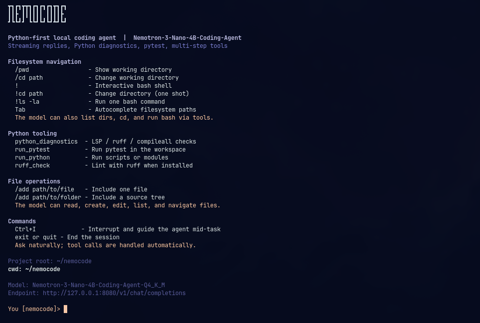
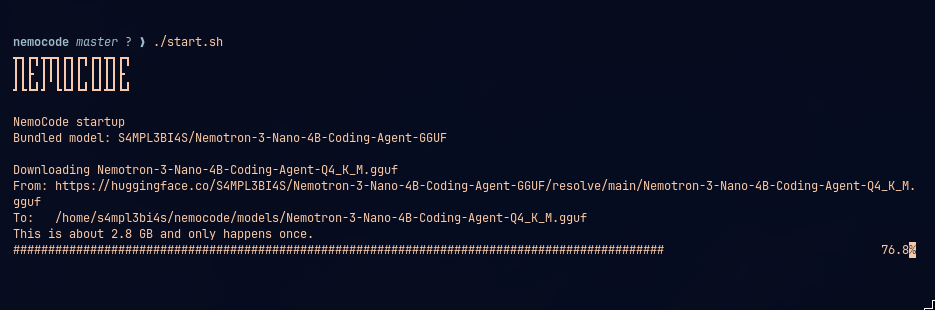
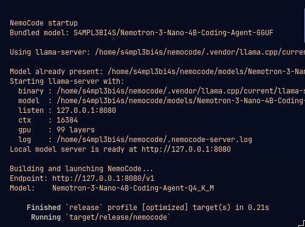
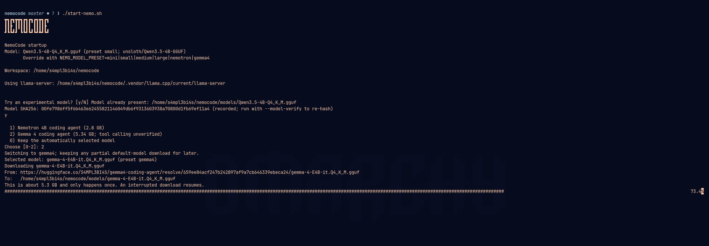

# NemoCode

Python-first local coding agent.

NemoCode is a Rust CLI harness optimized for Python development: streaming chat,
pytest/ruff helpers, diagnostics via basedpyright/pyright (with local fallbacks),
bash/filesystem navigation, and Tab path autocomplete. Other languages still work
through file tools and bash. The launcher picks an open-weight model sized for
the machine it runs on, from a 1.3 GB model for small laptops up to a 16.5 GB
model for a 24 GB GPU. See [Model](#model).

```
┳┓┏┓┳┳┓┏┓┏┓┏┓┳┓┏┓
┃┃┣ ┃┃┃┃┃┃ ┃┃┃┃┣ 
┛┗┗┛┛ ┗┗┛┗┛┗┛┻┛┗┛
```



## What it does

- Local-only inference through an OpenAI-compatible `llama-server`
- Python-first system prompt and `PYTHON PROJECT` context when a Python tree is detected
- First-class tools: `python_diagnostics`, `run_pytest`, `run_unittest`, `run_python`, `ruff_check`
- Lexical retrieval: `search_code`, `file_outline`, `index_directory`, ranged `read_file`
- Diagnostics-only LSP via `basedpyright-langserver` / `pyright-langserver` when installed
  (falls back to `ruff check` or Python AST syntax checks; no network needed once installed)
- Loading and thinking indicators with elapsed time while you wait
- Multi-step tool loop for files, directories, and bash (other languages via bash/files)
- Workspace permission modes: `read-only`, `workspace`, `trusted`
- Headless `nemocode run`, durable sessions, and management commands (`doctor`, `status`, `bench`)
- Vybrid-style filesystem navigation (`/cd`, `/pwd`, `!`, `!cd`, `!command`)
- Tab autocomplete for filesystem paths
- **Ctrl+I** to interrupt the agent mid-task and steer it without restarting the session

No cloud API keys and no hosted providers. Everything runs on your machine.

## Requirements

- Linux, macOS, or Windows (see [Windows](#windows))
- Rust toolchain (`cargo`)
- `curl` and `tar`
- `sha256sum` or `shasum` to verify downloads
- 1.3 to 16.5 GB of disk for the model, depending on the preset (2.7 GB for the
  default on an 8 GB machine), plus RAM/VRAM for inference
- Optional for best Python diagnostics: `basedpyright` or `pyright` on `PATH`
- Optional: `pytest`, `ruff`

`llama-server` is installed automatically on first launch from the official
[llama.cpp](https://github.com/ggml-org/llama.cpp) GitHub releases into
`.vendor/llama.cpp/`. If `llama-server` is already on your `PATH`, that binary
is used instead.

The normal launcher requires `curl` for runtime downloads and server health
checks, even though the model downloader also supports `wget`.

## Quick start

```bash
git clone https://github.com/SampleBias/nemocode.git
cd nemocode
chmod +x start-nemo.sh
./start-nemo.sh
```

The startup script will:

1. Print the NemoCode banner
2. Load literal `NEMO_*` values from `.env` (environment wins)
3. Install `llama-server` automatically if it is not already available
4. Pick a model preset for this machine and download its GGUF into `models/` if
   missing (resumable, and checked against the publisher's SHA-256)
5. Start `llama-server` with `--jinja` (required for tool calling)
6. Build and launch the NemoCode CLI against `http://127.0.0.1:8080/v1`

The launcher checks available disk space before a model download, resumes an
interrupted download, and moves a file with a failed checksum aside. It also
stops if another server responds to the health check on its configured port. A
source checkout is rebuilt before launch so an older CLI binary is not used by
accident.





### Choosing an experimental model

On an interactive launch with automatic model selection, the launcher begins
preparing the default model and asks whether to try an experimental model.



In this example, the automatically selected Qwen model is already present. The
user enters `y` at the prompt, then chooses `2` for the Gemma 4 coding agent;
the launcher switches models and shows the download in progress.

To try an experimental model yourself:

1. Enter `y` at **Try an experimental model?**
2. Enter `1` for Nemotron 4B or `2` for Gemma 4. Enter `0` to keep the
   automatically selected model.
3. The launcher downloads the selected model if needed, verifies it, and starts
   the server. If the default model was still downloading, its partial file is
   retained so that download can resume later.

Press Enter at the first prompt to keep the default. Explicit model settings and
non-interactive launches skip the prompt, as do model/runtime management
commands and attach mode. Gemma 4 tool calling is unverified.

## Windows

NemoCode runs natively on Windows 10 and 11. It needs
[Git for Windows](https://gitforwindows.org/), because the launcher and the
agent's shell tool both use its bash, and [Rust](https://rustup.rs/) to build
the CLI. From **Git Bash**:

```bash
git clone https://github.com/SampleBias/nemocode.git
cd nemocode
./start-nemo.sh
```

- The launcher selects the Vulkan build of `llama-server` when Vulkan is
  detected, and otherwise selects the CPU build. To select a backend yourself,
  use `NEMO_LLAMA_BACKEND=vulkan`, `cuda`, or `cpu`. The CUDA build also
  downloads its runtime libraries.
- GPU memory for the model preset is read from `nvidia-smi`. With another GPU
  brand, choose `NEMO_MODEL_PRESET` yourself if the automatic choice is too small.
- Shell commands run through Git's bash, not `cmd` or PowerShell. If bash is
  installed somewhere unusual, point `NEMO_BASH` at `bash.exe`.
- Python tools look for a virtualenv's `Scripts\python.exe`, then `python`,
  `py`, and finally `python3`.
- Session directories do not have the Unix `0700` access restrictions on
  Windows. Limit access to them using Windows permissions if needed.

## Launch rule

From a source checkout, `./start-nemo.sh` is the supported way to install the
runtime, download the GGUF, start `llama-server`, and launch the CLI.

The CLI itself can target any workspace:

```bash
nemocode --workspace ~/my_flask_app
nemocode run --workspace ~/my_flask_app --prompt "Add a /health endpoint"
```

Packaged installs (`scripts/package.sh`) store the model and `llama-server` under
`XDG_DATA_HOME/nemocode` (or `~/.local/share/nemocode`) instead of the checkout.

## Usage

```text
You [nemocode]> /cd ~/my_flask_app
Python project detected (pyproject.toml)
You [my_flask_app]> Add a /health endpoint and a pytest for it
Nemo> (reads files → edits → python_diagnostics → run_pytest)
You [my_flask_app]> /add app/
You [my_flask_app]> Refactor the routes module and keep tests green
You [my_flask_app]> exit
```

Other languages still work via file tools and bash when you ask; Python gets first-class tools and prompts.

### Commands

| Input | Effect |
| --- | --- |
| `/pwd` | Show the current working directory |
| `/cd path` | Change the process working directory |
| `!` | Enter interactive bash shell mode |
| `!cd path` | Change directory without entering shell mode |
| `!command` | Run one bash command in the current directory |
| `Tab` | Autocomplete filesystem paths |
| `/add path/to/file` | Add one file to conversation context |
| `/add path/to/folder` | Add a source tree (skips junk/binary/large files) |
| `Ctrl+I` or `Ctrl+C` | Interrupt the agent mid-task and send guidance (see below) |
| `exit` or `quit` | End the session |

### Interrupting the agent (Ctrl+I)

While the agent is generating a reply or running tools, press **Ctrl+I** to stop it
and steer the current task without ending the session. **Tab** and **Ctrl+C** do
the same: most terminals send Ctrl+I as Tab, and Ctrl+C cannot kill the process
while the agent is reading keys. Press Ctrl+C again at the guidance prompt to quit.

What happens:

1. Streaming stops immediately (including in-progress tool rounds).
2. Incomplete generated calls are discarded. Already committed file changes are
   retained and journaled; interruption is not a filesystem rollback.
3. You get a short prompt to enter guidance. Press **Enter** on an empty line to
   resume with no extra notes, or type a correction and press **Enter**.
4. The agent continues the same user turn with your guidance treated as higher
   priority than its previous plan.

You can use Ctrl+I during model output, while tools are running, or while a bash
command is executing. Long-running bash commands are killed when interrupted.

Example:

```text
You [nemocode]> Build a small Flask app in test_app/
Nemo> (generating…)
^I
── Interrupted (Ctrl+I) ──
Enter guidance for the agent. Empty line = continue without notes.
You [nemocode]> Use plain HTML templates, no Jinja macros
Guidance recorded — resuming.
Nemo> (continues with your correction)
```

### Tab autocomplete

Press `Tab` to complete paths:

- `/cd te` → `test/` (directories preferred for `/cd` and `!cd`)
- `/add sr` → files and folders under the current path
- `!cd`, `!ls`, and other `!` commands also complete path arguments
- Inside `!` shell mode, Tab completes filesystem paths anywhere on the line

### Filesystem navigation

Relative file-tool paths resolve against the live working directory. A
`SESSION LOCATION` block (cwd + project root) is injected on user turns. When the
workspace looks like a Python project (`pyproject.toml`, `requirements.txt`,
top-level `.py` files, etc.), a short `PYTHON PROJECT` block is added too.
Model navigation changes cwd, not the authorized workspace root. Both survive
session resume. User-directed `/cd` explicitly selects a new workspace root.

The model can navigate and retrieve via tools:

- `list_directory` / `index_directory`
- `search_code` / `file_outline`
- `change_directory`
- `execute_bash_command` (requires `--permission trusted`)

Plus file tools:

- `read_file` / `read_multiple_files` (numbered lines + SHA-256 revision; batched per-file ranges)
- `read_tool_output` (retrieve saved evidence omitted from the prompt)
- `create_file` / `create_multiple_files` (does not overwrite existing files)
- `edit_file` (one or several non-overlapping unique replacements, committed atomically against one revision)

Permission modes (`NEMO_PERMISSION` / `--permission`):

| Mode | Native file tools | Project checkers (`pytest`, `unittest`, `ruff`, diagnostics) | `execute_bash_command` / `run_python` |
| --- | --- | --- | --- |
| `read-only` | reads, search, outline, index | no | no |
| `workspace` | workspace-scoped reads and writes | yes | no |
| `trusted` (default) | any path | yes | yes |

In trusted mode, the agent can run shell commands and Python with your user
account's permissions, including outside the workspace. To restrict native file
operations and disable agent shell commands for a launch, use
`NEMO_PERMISSION=workspace ./start-nemo.sh`; use `read-only` to restrict it
further. Project checkers in workspace mode still execute project code.

### Python tooling

Prefer these over free-form bash for Python work:

| Tool | Effect |
| --- | --- |
| `python_diagnostics` | LSP diagnostics when available; else `ruff` / Python AST syntax checks |
| `run_pytest` | Run pytest (optional target / extra args) |
| `run_unittest` | Discover standard-library unittest tests (optional `start_directory`, `pattern`); empty/all-skipped suites do not pass |
| `run_python` | Run a script, `-m` module, or `-c` snippet (uses `.venv` Python when present; requires trusted permission) |
| `ruff_check` | Run `ruff check` when ruff is installed |

Install a language server locally if you want LSP diagnostics (example):

```bash
pip install basedpyright
# provides basedpyright-langserver
```

Set `NEMO_PYTHON_LSP=off` to skip LSP entirely, or override the command with
`NEMO_PYTHON_LSP_COMMAND`. The LSP protocol itself is local-only; internet is only
needed to install the server or fetch Python packages.

## Performance

NemoCode includes bounded resource controls and inference-efficiency mechanisms.
These are not a guarantee of faster or more accurate coding; see the
[edge validation report](docs/edge-review-2026-09-28.md) for measured results and limits.

| Feature | What it does |
| --- | --- |
| Default `max_tokens` 4096 | Smaller completion budget for faster tool turns |
| Sticky history budget | Keeps a stable prompt prefix; default ~12k tokens (`NEMO_CONTEXT_BUDGET`) |
| Measured context compaction | Uses the server's rendered token count before trimming older history; preserves the latest tool result |
| Experimental non-thinking coding turns | Disables the model template's thinking prefix and stops at one complete XML tool call; live coding reliability remains under investigation |
| Tool-result compaction | Context-scaled aggregate JSON limit; preserve complete source lines and retrieve omitted evidence from session artifacts |
| Loading and thinking indicators | Show elapsed time while the model loads and until a response begins |
| Tool-call stream feedback | Single-line args spinner (name × count · size) while tool JSON streams |
| Tool-call stream guards | Rejects incomplete/runaway calls; bounded protocol recovery and accounting for interrupted generation |
| SSE idle timeout | Aborts if no SSE chunk for 5 minutes (`NEMO_SSE_IDLE_TIMEOUT_SECS`; `0` = forever) |
| Bash / parallel progress | Elapsed spinner for bash; spinner + done line for parallel reads |
| SESSION LOCATION + PYTHON PROJECT | Injects cwd/root (and Python markers when detected) on user turns |
| Parallel read-only tools | Runs multiple reads/lists in one round concurrently |
| No-progress guard | Normalizes paths and outcomes across all tools; prompts recovery after 3 repeats and bounds stalled retries |
| Immutable tool history | Appends state updates once, preserving prior message bytes until deliberate compaction |
| Batched operations | Per-file read ranges and atomic multi-replacement edits reduce required model round trips |
| Bounded search | Literal search over protected-path-filtered files; uses ripgrep when available and a bounded fallback otherwise |
| File-read cache | Caches by path + mtime + size; cleared on edit / `cd` / bash |

## Configuration

Copy `.env.example` to `.env` if you want persistent overrides.

| Variable | Default | Meaning |
| --- | --- | --- |
| `NEMO_BASE_URL` | `http://127.0.0.1:8080/v1` | Local OpenAI-compatible base URL |
| `NEMO_MODEL` | the GGUF file name, e.g. `Qwen3.5-4B-Q4_K_M` | Model id sent to the server |
| `NEMO_API_KEY` | `local` | Optional; unused unless the server enforces auth |
| `NEMO_MAX_TOKENS` | `4096` | Max completion tokens per model request |
| `NEMO_MAX_CONTINUATIONS` | `2` | Auto-resume when output hits the token limit |
| `NEMO_TOOL_ROUNDS` | `32` | Max tool-call rounds per user turn |
| `NEMO_TASK_TOKENS` | `16384` | Max generated tokens for one user task |
| `NEMO_TASK_TIMEOUT_SECS` | `900` | Wall-clock budget for one user task |
| `NEMO_PERMISSION` | `trusted` | `read-only` / `workspace` / `trusted` |
| `NEMO_TEMPERATURE` | `0.6` | Sampling temperature |
| `NEMO_TOP_P` | `0.95` | Nucleus sampling |
| `NEMO_TOP_K` | `20` | Top-k sampling (the Qwen model cards recommend 20) |
| `NEMO_SEED` | `-1` | Server seed (`-1` leaves sampling unseeded) |
| `NEMO_THINKING` | `off` | Set `on` to opt into template thinking; reasoning text never executes tools |
| `NEMO_CONTEXT_BUDGET` | `NEMO_CTX - NEMO_MAX_TOKENS - 512` | Max prompt tokens (messages + tool schemas); auto-compacts/retries on overflow |
| `NEMO_SSE_IDLE_TIMEOUT_SECS` | `300` (5 min) | Abort if the SSE stream stalls; `0` waits forever |
| `NEMO_PYTHON_LSP` | `auto` | `auto` / `off` / path-or-command for the Python language server |
| `NEMO_PYTHON_LSP_COMMAND` | unset | Optional full command (for example `basedpyright-langserver --stdio`) |
| `NEMO_WORKSPACE` | current directory | Workspace root; also `--workspace PATH` |
| `NEMO_SESSION_DIR` | `~/.local/state/nemocode/sessions/<id>` | Durable journal + checkpoint directory |
| `NEMO_CONFIG` | `$NEMO_WORKSPACE/.env` | Literal `NEMO_*` key=value file (not shell) |
| `NEMO_LEGACY_TEXT_TOOLS` | on | Run a complete XML tool call the server left in the reply text; `0` disables |

A `.env` that is merely found in another workspace cannot set privileged options:
`NEMO_PERMISSION=trusted` and settings that name an executable
(`NEMO_PYTHON_LSP_COMMAND`, `NEMO_LLAMA_SERVER`, `NEMO_CLI`, ...) are ignored
there with a warning. Set them in the environment, in the NemoCode checkout's own
`.env`, or in a file you select with `NEMO_CONFIG` / `--config`.

Launcher overrides for `./start-nemo.sh`:

| Variable | Default | Meaning |
| --- | --- | --- |
| `NEMO_MODEL_PRESET` | `auto` | `mini`, `small`, `medium`, `large`, `nemotron`, or `gemma4`; `auto` picks by RAM/VRAM |
| `NEMO_MODEL_REPO` / `NEMO_MODEL_FILE` | from the preset | Any other Hugging Face GGUF with a tool-calling template |
| `NEMO_MODEL_PATH` | `models/<preset file>` | Local GGUF path |
| `NEMO_MODEL_REVISION` | pinned per preset | Repository revision; `main` follows upstream without the pinned checksum |
| `NEMO_MODEL_SHA256` | pinned per preset | Expected SHA-256 of the GGUF |
| `NEMO_SERVER_START_TIMEOUT` | `300` | Seconds to wait for the model to load |
| `NEMO_HOST` / `NEMO_PORT` | `127.0.0.1` / `8080` | Server bind address |
| `NEMO_CTX` | `16384` (`32768` for `large`) | Context size |
| `NEMO_GPU_LAYERS` | `auto` | GPU offload layers (`0` for CPU; `auto` / `fit` for low-VRAM) |
| `NEMO_THREADS` | unset | Optional CPU thread count |
| `NEMO_PARALLEL` | `1` | Server slots (1 = full context for single-agent use) |
| `NEMO_FLASH_ATTN` | `on` | Flash Attention (`on` / `off` / `auto`) |
| `NEMO_BATCH` | `2048` | Logical batch size for prefill |
| `NEMO_UBATCH` | `512` | Physical micro-batch size |
| `NEMO_CACHE_TYPE_K` / `NEMO_CACHE_TYPE_V` | `q8_0` | KV cache element types |
| `NEMO_MLOCK` | unset | Set `1` to pin the model in RAM (`--mlock`) |
| `NEMO_LLAMA_SERVER` | auto-detect / auto-install | Path to `llama-server` |
| `NEMO_LLAMA_BACKEND` | auto | Force `cpu`, `vulkan`, `cuda`, or `rocm` for auto-install |
| `NEMO_LLAMA_RELEASE` | latest | Pin a llama.cpp release tag (for example `b10043`) |
| `NEMO_VENDOR_DIR` | `.vendor/llama.cpp` | Where auto-installed binaries are stored |

Example CPU-only launch:

```bash
NEMO_GPU_LAYERS=0 NEMO_CTX=8192 ./start-nemo.sh
```

Starting-point hardware profiles (measure on the target device before relying on them):

```bash
set -a && source profiles/cpu-small.env && set +a && ./start-nemo.sh
set -a && source profiles/balanced.env && set +a && ./start-nemo.sh
```

## CLI

After `llama-server` is up (or after `./start-nemo.sh`):

```text
nemocode [chat] --workspace PATH
nemocode run --workspace PATH --prompt TEXT [--permission read-only|workspace|trusted]
nemocode --resume SESSION_DIR [--prompt TEXT] run
nemocode doctor | status | config | bench
nemocode runtime install|start|update
nemocode model install|verify
```

Headless `run` prints one JSON object to stdout and writes a durable journal.
`ok` / `execution_ok` describe controller completion, not proven code correctness.
Use `task_outcome` (`completed`, `completed_unverified`, `incomplete`) and
`verification_status` (`passed`, `diagnostics_only`, `unverified`, `failed`,
`incomplete`) to distinguish successful behavior checks from syntax-only or
missing verification. Failed/stale checks cannot silently become a verified pass.
Project tests are evidence, not a proof that all requested behavior is correct;
the evaluation runner also uses independent assertions outside the agent workspace.

```bash
cargo run --release -- run --workspace ~/my_flask_app --prompt "Add a /health endpoint"
```

## Manual run

If the server is already running:

```bash
export NEMO_BASE_URL=http://127.0.0.1:8080/v1
export NEMO_MODEL=Qwen3.5-4B-Q4_K_M
cargo run --release -- --workspace "$PWD"
```

Example `llama-server` command:

```bash
llama-server \
  --model models/Qwen3.5-4B-Q4_K_M.gguf \
  --host 127.0.0.1 \
  --port 8080 \
  --ctx-size 16384 \
  --n-gpu-layers 99 \
  --parallel 1 \
  --flash-attn on \
  --batch-size 2048 \
  --ubatch-size 512 \
  --cache-type-k q8_0 \
  --cache-type-v q8_0 \
  --jinja
```

## Model

`./start-nemo.sh` chooses a preset from the machine's memory. Set
`NEMO_MODEL_PRESET` to choose yourself.

| Preset | Model (Q4 GGUF) | Download | Picked automatically for | License |
| --- | --- | ---: | --- | --- |
| `mini` | [Qwen3.5-2B](https://huggingface.co/unsloth/Qwen3.5-2B-GGUF) | 1.3 GB | Detected RAM below 7,000 MiB when GPU memory is below 3,500 MiB | Apache-2.0 |
| `small` | [Qwen3.5-4B](https://huggingface.co/unsloth/Qwen3.5-4B-GGUF) | 2.7 GB | 3,500–6,999 MiB detected GPU memory, or the default when no larger GPU or low RAM is detected | Apache-2.0 |
| `medium` | [Qwen3.5-9B](https://huggingface.co/unsloth/Qwen3.5-9B-GGUF) | 5.7 GB | 7,000–21,999 MiB detected GPU memory | Apache-2.0 |
| `large` | [Qwen3.8-27B](https://huggingface.co/unsloth/Qwen3.8-27B-GGUF) | 16.5 GB | 22,000 MiB or more detected GPU memory | Apache-2.0 |
| `nemotron` | [Nemotron-3-Nano-4B-Coding-Agent](https://huggingface.co/S4MPL3BI4S/Nemotron-3-Nano-4B-Coding-Agent-GGUF) | 2.8 GB | never; the original NemoCode model | NVIDIA Nemotron Open Model License |
| `gemma4` | [Gemma 4 coding agent](https://huggingface.co/S4MPL3BI4S/gemma4-coding-agent) | 5.34 GB | never; experimental opt-in | See model repository |

How the choice is made:

- GPU memory comes from `nvidia-smi`. On Apple Silicon two thirds of system RAM
  counts as GPU memory. AMD and Intel GPU memory is not detected, so the choice
  falls back to system RAM unless you set the preset.
- GPU memory takes priority over RAM when it reaches 3,500 MiB. With no
  detected GPU memory, the launcher selects `mini` for detected RAM below
  7,000 MiB and `small` otherwise, including when RAM cannot be detected.
- Without a detected GPU the 4B model is the ceiling. Larger models load on a
  CPU but generate too slowly for a multi-step tool loop.
- None of the repositories is gated, so no Hugging Face account is needed.
- Each preset pins a repository revision and that file's SHA-256, so a download
  is verified against the publisher's own checksum.

Why these models: all four share the XML tool-call template this harness already
handles (`<tool_call><function=...>`), expose the same `enable_thinking` switch,
and are Apache-2.0. The original Nemotron fine-tune passed at most one of the
four fixtures in this repository's recorded runs
([November evaluation](docs/validation/2026-11-02-harness-evaluation.md)); it
stays available as `NEMO_MODEL_PRESET=nemotron`.

Not yet measured: the new presets have not been run through `evals/run.py`. The
selection rests on the model cards, published benchmarks, and the template
match, so record a baseline on your hardware before relying on it.

To choose the original model explicitly, run:

```bash
NEMO_MODEL_PRESET=nemotron ./start-nemo.sh
```

To try the Gemma 4 coding-agent fine-tune, run:

```bash
NEMO_MODEL_PRESET=gemma4 ./start-nemo.sh
```

This selects the text-only Q4_K_M GGUF. Its embedded chat template does not
describe tool calls, and its tool-calling behavior with NemoCode has not been
validated; treat it as experimental. The launcher does not load the separate
vision projector.

Any other GGUF whose chat template supports tool calling works too:

```bash
NEMO_MODEL_REPO=ibm-granite/granite-4.2-3b-GGUF \
NEMO_MODEL_FILE=granite-4.2-3b-Q4_K_M.gguf ./start-nemo.sh
```

Model weights are governed by their own licenses, linked above. The NemoCode
harness itself is MIT-licensed.

## Project layout

```text
nemocode/
  Cargo.toml
  LICENSE
  README.md
  start-nemo.sh
  .env.example
  src/main.rs           # REPL, streaming, tool loop
  src/process.rs        # bounded subprocess capture
  src/runtime.rs        # CLI, doctor/status/bench, config
  src/session.rs        # task state, journals, checkpoints
  src/storage.rs        # atomic writes, SHA-256 revisions
  src/retrieval.rs      # lexical search / outline / index
  src/python_project.rs # Python tree detection / PYTHON PROJECT block
  src/python_tools.rs   # pytest / run_python / ruff / AST fallback
  src/lsp/              # diagnostics-only Python LSP client
  profiles/             # starting-point hardware env files
  evals/                # public regression fixtures
  scripts/package.sh    # relocatable native tarball
  docs/implementation.md
  docs/assets/          # README screenshots
  models/               # downloaded GGUF (gitignored)
  .vendor/llama.cpp/    # auto-installed llama-server (gitignored)
```

## What's next

See [docs/implementation.md](docs/implementation.md) for the engineering list. Short version:

1. Measure `profiles/cpu-small.env` and `profiles/balanced.env` on real devices; treat current values as starting points.
2. Run `python3 evals/run.py` against each model preset with a live server and record a baseline. Keep private held-out tasks out of git.
3. Tag a relocatable 0.1 tarball from `scripts/package.sh` / the CI artifact.
4. Add REPL session list/resume; `--resume` already works for headless `run`.
5. Windows: session directories are not access-restricted the way they are on Unix (mode 0700), and non-NVIDIA GPU memory is not detected.
6. Grow evals past the four-task smoke set, including stale-edit recovery and larger multi-file refactors.

Run the additional public smoke set with
`python3 evals/run.py --tasks evals/extended_tasks.json` against a running server;
add `--list` to list its tasks. Reports include configuration and artifact hashes,
seeds, and independent validator results. Keep held-out tasks separate. A
successful syntax check does not establish behavioral correctness. Workspace
mode restricts native file paths, but project checkers execute project code and
are not a system sandbox. The [November evaluation](docs/validation/2026-11-02-harness-evaluation.md)
records results for an earlier harness revision, before the current main branch's
edge improvements.

See the [September 9 build review](docs/build-review-2026-09-09.md) for completed
fixes, release checks, and live validation results.
The [follow-up checkpoint](docs/evaluation-fixes-2026-09-09.md) records the
unfinished live-model investigation and the next experiment to run.

## License

MIT. See [LICENSE](LICENSE).
